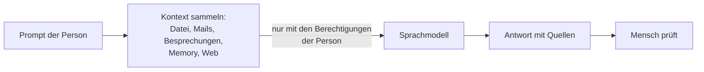

# Lab 1.2: Kontext ist alles

**Leitfragen:**

Was braucht eine neue Kollegin, um eine Kundenanfrage ohne Rückfrage zu beantworten?

Den Auftrag, die passenden Unterlagen, den bisherigen Mail- und Besprechungsverlauf und die ungeschriebenen Regeln des Hauses. Einem KI-Assistenten fehlt genau dasselbe, solange es ihm niemand mitgibt.

Warum liefert dieselbe Frage bei zwei Personen unterschiedliche Antworten?

Jede Person hat andere Mails, Dateien, Besprechungen und Berechtigungen (Lab 1.1). Copilot antwortet mit dem, was es bei der fragenden Person findet; dazu kommen gespeicherte Vorlieben und die Tatsache, dass ein Sprachmodell nie exakt gleich formuliert.

Wie gut sind Ablage und Benennung von Dateien im eigenen Bereich?

Darauf gibt es keine allgemeine Antwort. Für Copilot zählt: Liegt der aktuelle Stand an einem Ort, ist er eindeutig benannt, und ist veraltetes Material als solches erkennbar?

- Antwortqualität = Modell × Kontext. Die Modelle der großen Anbieter liegen nah beieinander; den Unterschied macht der Kontext.
- Wer den Kontext steuert, steuert die Qualität – und das Risiko.
- Datenqualität, Ablagestruktur und Berechtigungen entscheiden, wie gut Copilot wird und was es preisgeben kann.

## Begriffe

| Begriff | Bedeutung |
| --- | --- |
| Kontext | alles, was das Sprachmodell zusätzlich zur Frage erhält: Auftrag, Dateien, Mails, Verlauf, Vorlieben. Wie die Unterlagenmappe, die eine neue Kollegin zum Auftrag bekommt. |
| Referenzierte Datei | Datei, die im Prompt ausdrücklich genannt wird (in den Apps über `/` und den Dateinamen); Copilot nutzt dann deren Inhalt statt einer Beschreibung |
| Arbeitsmodus | Einstellung in Copilot Chat, in der Copilot zusätzlich zu Web und Dateien die Arbeitsdaten über Microsoft Graph nutzt; nur mit Microsoft-365-Copilot-Lizenz |
| Memory | Copilot merkt sich Vorlieben und Fakten einer Person über mehrere Chats hinweg; einsehbar und löschbar |
| Quellenangabe | Verweis in der Antwort auf die Mail, Datei oder Besprechung, aus der eine Aussage stammt |

## Kontextquellen

| Quelle | Beispiel | Wer steuert sie? |
| --- | --- | --- |
| Auftrag (Prompt) | „Fasse den Stand für die Geschäftsführung in fünf Punkten zusammen" | die nutzende Person |
| Referenzierte Datei | `/nordwind-projektnotizen.docx` | die nutzende Person |
| Arbeitsdaten über Microsoft Graph | Mails, Chats, Besprechungen, Dateien, Kalender | Ablage und Berechtigungen der Organisation |
| Web | öffentliche Informationen | Tenant-Einstellung |
| Memory | „Bevorzugt Antworten in Stichpunkten", „Leitet das Projekt Hafenmodernisierung" | die Person; Einstellungen der Organisation |

Weitere Quellen wie Wissensdateien, Skills und angebundene Fachsysteme folgen in Modul 2.

## Der Weg einer Anfrage

Das Schaubild gilt für alle weiteren Labs; Modul 2 ergänzt nur weitere Quellen.

## So sieht es aus: dieselbe Frage dreimal

Die Demo stellt dieselbe Nordwind-Frage in Copilot Chat mit unterschiedlichem Kontext. Grundlage sind [`nordwind-projektnotizen.docx`](../../project/nordwind-projektnotizen.md) und das [Jour-fixe-Protokoll](../../project/nordwind-jourfixe-protokoll.md); im Demo-Tenant liegen dazu Mails und die Teams-Besprechung.

**Frage (Beispiel):** „Wie ist der Stand im Projekt Hafenmodernisierung, und was muss diese Woche passieren?"

| Variante | Kontext | Antwort (Beispiel, gekürzt) | Bewertung |
| --- | --- | --- | --- |
| 1 ohne Kontext | nur die Frage | „Hafenmodernisierungen umfassen typischerweise Bestandsaufnahme, Planung und Umsetzung. Wichtig sind ein klarer Zeitplan, regelmäßige Abstimmung mit Stakeholdern …" | allgemein, kein einziger Nordwind-Fakt |
| 2 mit Datei | `/nordwind-projektnotizen.docx` | „AP1 abgeschlossen, AP2 bei 70 %, Freigabe seit 11.09. offen; Budget 38,9 % verbraucht. Diese Woche: Eskalationsgespräch zur AP2-Freigabe, Nachfrage Testsystemzugang." | konkret und korrekt, aber nur der Stand der Notizen |
| 3 Arbeitsmodus | Mails, Teams-Besprechung, Dateien | wie 2, zusätzlich: „Im Jour fixe am 11.09. blieb die Zuständigkeit für die Datenmigration offen. Die Nachfrage vom 22.09. zur AP2-Freigabe ist unbeantwortet." mit Quellen zu Mail und Besprechung | vollständigstes Bild; jede Aussage lässt sich über die Quelle prüfen |

Kernaussage: Das Modell war in allen drei Varianten dasselbe. Geändert hat sich nur der Kontext.

## Memory

- Copilot kann sich Vorlieben und Fakten einer Person merken und in späteren Chats nutzen, z. B. Rolle, Projekt oder gewünschtes Antwortformat.
- Gespeicherte Einträge sind in den Copilot-Einstellungen einsehbar und einzeln löschbar; Memory lässt sich abschalten.
- Laut Microsoft ist Memory standardmäßig aktiv und kann auch aus dem Chatverlauf abgeleitete Einträge enthalten; Administratoren können Memory-Daten über eDiscovery (Microsoft-Werkzeug zum Durchsuchen von Daten für rechtliche Prüfungen) durchsuchen.
- Folge für Entscheider: Memory ist zusätzlicher Kontext und zugleich personenbezogene Information (Datenschutz und Mitbestimmung in Modul 3).

Quellen: Microsoft Learn, [Copilot personalization and memory](https://learn.microsoft.com/en-us/microsoft-365/copilot/copilot-personalization-memory); Microsoft Support, [Manage Copilot Memory](https://support.microsoft.com/en-US/Microsoft-365-Copilot/manage-copilot-memory-in-microsoft-365-copilot). Stand: 31.10.2026. Funktionsumfang hängt von Lizenz, Tenant-Einstellungen und Rollout ab; vor dem Kurs prüfen.

## So sieht es aus: ein Nordwind-Arbeitstag in vier Apps

Vier kurze Demo-Clips zeigen Copilot direkt in den Apps. Jede App arbeitet mit dem Kontext, der in ihr liegt.

| App | Eingabe | Was Copilot tat (Beispiel) | Prüfpunkt |
| --- | --- | --- | --- |
| Outlook | Mailverlauf zum Projekt mit Stadtwerke Nordhafen (`nordwind-mailverlauf.md`, im Demo-Postfach) | fasste den Verlauf in vier Punkten zusammen, nannte die unbeantwortete Nachfrage vom 22.09. und schlug eine Antwort vor | Antwortentwurf vor dem Versand lesen und anpassen |
| Teams | Jour fixe vom 11.09. (Inhalt wie [Jour-fixe-Protokoll](../../project/nordwind-jourfixe-protokoll.md)) | listete Beschlüsse, offene Punkte und Aufgaben mit Namen, u. a. „Datenmigration: keine Einigung" | Zusammenfassung braucht Transkription; Aufgaben mit Namen beziehen sich auf Personen |
| Word | [`nordwind-projektnotizen.docx`](../../project/nordwind-projektnotizen.md) | entwarf einen Statusbericht mit Arbeitspaketen, Risiken und nächsten Schritten | Zahlen und Termine gegen die Notizen prüfen; keine erfundenen Details |
| Excel | [`nordwind-budget-daten.xlsx`](../../project/nordwind-budget-daten.md) | beantwortete „Welcher Kostenblock ist am größten?" mit Personal (40.600 €) und schlug ein Diagramm vor | Ergebnis gegen die Kontrollsumme 71.500 € gegenrechnen |

_Quelle: Microsoft Support, „How Copilot Chat works in Microsoft 365 apps" (https://support.microsoft.com/en-us/microsoft-365-copilot/how-copilot-chat-works-in-microsoft-365-apps), abgerufen am 31.10.2026._

Stand der Clips: 31.10.2026. Oberfläche und Funktionsumfang hängen von Lizenz, Tenant-Einstellungen und Rollout ab; vor dem Kurs prüfen.

> **Merksatz:** Das Modell ist austauschbar, der Kontext nicht. Wer Ablage und Berechtigungen ordnet, verbessert Copilot und senkt das Risiko zugleich.

## Folgen für Entscheider

| Hebel | Wirkung auf Qualität | Wirkung auf Risiko |
| --- | --- | --- |
| aktuelle, eindeutig benannte Dateien | Copilot findet den richtigen Stand | weniger veraltete Aussagen |
| aufgeräumte Freigaben | Treffer passen zur Rolle | weniger Preisgabe vertraulicher Dateien |
| Besprechungen mit Transkription | Nachbereitung möglich | Personenbezug, Zustimmung und Mitbestimmung nötig |
| Memory aktiv | weniger Wiederholung im Prompt | zusätzliche gespeicherte Personendaten |

## Grenzen

- Fehlender Kontext erzeugt eine allgemeine Antwort, keine Fehlermeldung.
- Widersprüchliche oder veraltete Dateien landen ebenso im Kontext wie korrekte.
- Quellenangaben erleichtern die Prüfung, ersetzen sie aber nicht.

## Fazit

- Antwortqualität = Modell × Kontext; der Kontext macht den Unterschied.
- Kontext kommt aus Auftrag, Dateien, Arbeitsdaten, Web und Memory – und immer nur im Rahmen der Berechtigungen.
- Ordnung in Ablage und Freigaben ist die wirksamste Vorbereitung auf Copilot.

In der Übung wird der Abschnitt „Nutzen je App" der Nordwind-Entscheidungsvorlage geprüft und korrigiert.
