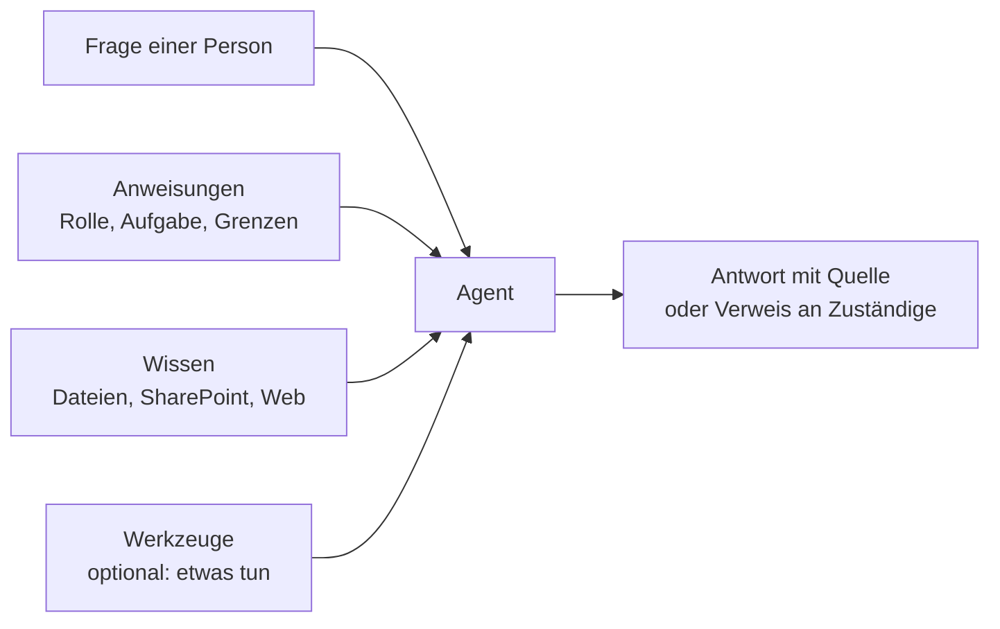

# Lab 2.1: Eigene Agenten: Copilot für jede Aufgabe

**Leitfragen:**

Welche Fragen beantwortet das eigene Team immer wieder?

Meist dieselben zehn bis zwanzig: Zugänge, Abläufe, Vorlagen, Zuständigkeiten. Genau diese wiederkehrenden Fragen sind der beste Start für einen eigenen Agenten (ein gespeicherter Spezialassistent, siehe unten).

Wann lohnt es sich, einen guten Auftrag dauerhaft aufzuheben, statt ihn jedes Mal neu zu formulieren?

Wenn mehrere Personen dieselbe Aufgabe regelmäßig mit denselben Regeln und Quellen erledigen. Dann wird aus dem einzelnen Prompt ein Agent, der Auftrag, Wissen und Grenzen dauerhaft mitbringt.

Wer sollte im Unternehmen einen solchen Assistenten bauen dürfen – jede Fachabteilung oder nur die IT?

Bauen kann die Fachabteilung, denn sie kennt das Wissen. Die IT legt die Regeln fest (wer darf bauen und teilen, welche Quellen sind erlaubt), und vor dem Teilen gibt eine benannte Rolle frei.

- Ein Agent ist ein gespeicherter Spezialassistent: Anweisungen, Wissen und Werkzeuge, einmal festgelegt und immer wieder nutzbar.
- Mit dem Agent Builder in Copilot Chat entsteht ein einfacher Agent ohne Code in wenigen Minuten. Die Entscheidung liegt deshalb weniger bei der Technik als bei Zweck, Quellen und Freigabe.

## Begriffe

| Begriff | Bedeutung |
| --- | --- |
| Prompt | der Auftrag, der in Copilot eingetippt wird; gilt nur für diese eine Anfrage |
| Agent | gespeicherter Spezialassistent mit festen Anweisungen, Wissen und ggf. Werkzeugen; wie eine eingearbeitete Fachkraft statt einer Aushilfe, der jedes Mal alles erklärt werden muss |
| Anweisungen | Text, der dem Agenten Rolle, Aufgabe, Ton und Grenzen vorgibt; gilt für jede Frage an diesen Agenten |
| Wissen | Dateien, SharePoint-Seiten oder Websites, die der Agent beim Antworten heranzieht |
| Werkzeug (Aktion) | Fähigkeit, etwas zu tun statt nur zu antworten, z. B. ein Ticket anlegen; bei einfachen Agenten oft nicht nötig |
| Agent Builder | Bereich in Copilot Chat, in dem ein Agent per Beschreibung oder Formular ohne Code angelegt, getestet und geteilt wird |
| vorgefertigter Agent | von Microsoft mitgelieferter Agent für eine Standardaufgabe, ohne eigene Einrichtung nutzbar |

## Prompt oder Agent?

| | Prompt | Agent |
| --- | --- | --- |
| Lebensdauer | eine Anfrage | dauerhaft gespeichert |
| Regeln und Ton | jedes Mal neu formulieren | einmal in den Anweisungen festgelegt |
| Wissen | Datei jedes Mal referenzieren | fest hinterlegt |
| Nutzende | eine Person | auch für ein Team oder eine Abteilung teilbar |
| Aufwand | keiner | Einrichtung, Test, Pflege und ein Owner |

Faustregel: Wird dieselbe Aufgabe mit denselben Quellen mehr als einmal pro Woche von mehreren Personen erledigt, lohnt ein Agent.

## Bausteine eines Agenten

Jeder Agent besteht aus drei Bausteinen, die zusammen auf die Frage einer Person antworten:

- Die Berechtigungen aus Lab 1.1 gelten weiter: Ein Agent zeigt nur Inhalte, die die fragende Person selbst sehen darf.
- Die Anweisungen sind der wichtigste Hebel: Was nicht drinsteht (z. B. „bei Gehaltsfragen an HR verweisen"), entscheidet das Modell selbst.

## Vorgefertigte und eigene Agenten

| Art | Beispiel | Einrichtung |
| --- | --- | --- |
| vorgefertigt | Microsoft-Agenten für Recherche oder Datenanalyse (z. B. „Researcher", „Analyst") | keine; Verfügbarkeit hängt von der Lizenz ab |
| eigener Agent im Agent Builder | Nordwind IT-Helfer mit der IT-Richtlinie | Minuten, ohne Code |
| Ausbau durch die IT | Agent mit Aktionen in Fachsystemen | Projekt mit Entwicklungs- und Freigabeaufwand |

Stand: 31.10.2026. Funktionsumfang hängt von Lizenz, Tenant-Einstellungen und Rollout ab; vor dem Kurs prüfen.

## So sieht es aus: Agent Builder

_Quelle: Microsoft Learn, Agent Builder overview (https://learn.microsoft.com/en-us/microsoft-365/copilot/extensibility/agent-builder), abgerufen am 31.10.2026._

- Ein Agent entsteht auf zwei Wegen: im Dialog beschreiben („Erstelle einen Agenten, der …") oder über „Configure" die Felder Name, Beschreibung, Anweisungen und Wissen direkt ausfüllen.
- Vor dem Teilen wird der Agent im Testbereich mit echten Fragen geprüft.
- Laut Microsoft Learn ist der Agent Builder in Copilot Chat (Web und Teams) verfügbar; Administratoren können ihn ein- oder ausschalten. Welche Wissensquellen ohne Microsoft-365-Copilot-Lizenz möglich sind, hängt von Lizenz und Tenant ab (Stand: 31.10.2026, vor dem Kurs prüfen).
- Aktionen in externen Systemen unterstützt der Agent Builder nicht; dafür ist ein Ausbau durch die IT nötig.

## Beispiele je Abteilung

| Abteilung | Agent | Wissen | Grenze in den Anweisungen |
| --- | --- | --- | --- |
| IT | IT-Helpdesk: VPN, Passwort, Geräte | IT-Richtlinie | Sonderberechtigungen → Ticket-Portal |
| HR | Onboarding-Begleiter für die ersten 30 Tage | Onboarding-Leitfaden | Gehalt, Vertrag → HR |
| Vertrieb | Angebotsassistent: Entwurf nach Hausregeln | Angebotsvorlage, Formulierungsregeln | keine Preise erfinden, Freigabe durch Vertriebsleitung |

## Wer baut, wer gibt frei?

| Rolle | Aufgabe |
| --- | --- |
| Fachabteilung | baut den Agenten, liefert und pflegt das Wissen, ist Owner |
| IT | legt fest, wer bauen und teilen darf und welche Quellen erlaubt sind |
| Datenschutz | wird eingebunden, sobald Personendaten im Wissen oder in den Fragen vorkommen |
| Freigabe (z. B. Bereichsleitung) | entscheidet, ob ein Agent über das eigene Team hinaus geteilt wird |

> **Merksatz:** Ein Agent ist so gut und so sicher wie seine Anweisungen, sein Wissen und der Kreis, mit dem er geteilt wird.

## Grenzen

- Ein Agent erweitert keine Berechtigungen; wer eine Datei nicht sehen darf, bekommt sie auch über den Agenten nicht.
- Veraltetes Wissen erzeugt veraltete Antworten; ohne Owner und Pflege verliert ein Agent schnell Vertrauen.
- Ein geteilter Agent mit internem Wissen erreicht alle, mit denen er geteilt wird. Der Nutzerkreis ist deshalb eine Entscheidung, keine Formalie.

## Fazit

- Agent = Anweisungen + Wissen + ggf. Werkzeuge, dauerhaft gespeichert und teilbar.
- Der Agent Builder macht den Bau einfach; schwer sind Zweck, Grenzen, Nutzerkreis und Owner.
- Fachabteilung baut, IT setzt den Rahmen, eine benannte Rolle gibt das Teilen frei.

Die Übung prüft das Beispiel „Nordwind IT-Helfer" und korrigiert den Abschnitt „Erste Agentenidee" der Entscheidungsvorlage.
