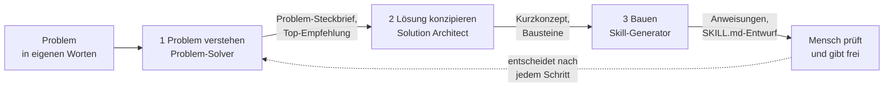

# Lab 2.2: KI baut KI: Skills und Markdown-Dateien

**Leitfragen:**

<details>
<summary>Wo ist das Wissen „wie wir das hier machen" im eigenen Bereich heute aufgeschrieben – oder steckt es nur in Köpfen?</summary>

Meist verstreut: einiges im Wiki, vieles in Mails und das Wichtigste in den Köpfen weniger Erfahrener. Ein Agent kann nur nutzen, was aufgeschrieben ist.

</details>

<details>
<summary>Was geht verloren, wenn eine erfahrene Kollegin das Unternehmen verlässt?</summary>

Das Vorgehen: Reihenfolge, Ausnahmen, Ansprechpersonen, typische Fehler. Als kurze Textdatei festgehalten, bleibt es für Menschen und Agenten nutzbar.

</details>

<details>
<summary>Könnte ein Assistent dabei helfen, die Anleitung für einen anderen Assistenten zu schreiben?</summary>

Ja: KI kann das Problem strukturieren, eine Lösung vorschlagen und die Anleitung entwerfen. Der Mensch entscheidet in jedem Schritt und prüft das Ergebnis gegen die Quellen.

</details>

- Erfahrungswissen wird als einfache Textdatei (Markdown) festgehalten: als Wissensdatei mit Fakten oder als Skill mit einer Anleitung für eine Aufgabe.
- „KI baut KI": KI hilft, diese Dateien und die Anweisungen für Agenten zu erstellen; der Mensch entscheidet und prüft.

## Begriffe

| Begriff | Bedeutung |
| --- | --- |
| Markdown | einfache Textdatei (Endung `.md`) mit wenigen Zeichen für Gliederung, z. B. `#` für Überschriften und `-` für Listen; lesbar für Mensch und KI, öffnet sich in jedem Editor |
| Wissensdatei | Markdown- oder Office-Datei mit Fakten oder Regeln, die ein Agent als Wissen durchsucht (wie ein Handbuch im Regal) |
| Skill | Markdown-Datei `SKILL.md` mit einer Anleitung für eine abgegrenzte Aufgabe, die ein Agent nur bei Bedarf lädt (wie eine Checkliste, die erst bei der passenden Aufgabe aus der Schublade kommt) |
| Frontmatter | Kopfbereich einer Markdown-Datei zwischen zwei `---`-Zeilen mit festen Feldern, z. B. `name` und `description` |
| KI baut KI | Vorgehen, bei dem KI-Assistenten Problem, Konzept und Anleitung für einen anderen Agenten erarbeiten |
| Owner | benannte Rolle, die eine Datei fachlich verantwortet, aktuell hält und Änderungen freigibt |

## Das Problem: Wissen in Köpfen

- Bei Nordwind kennen nur zwei Personen in HR das Onboarding-Vorgehen; neue Mitarbeitende fragen in den ersten 30 Tagen immer wieder dasselbe.
- Ein Agent mit dem Onboarding-Leitfaden beantwortet Fakten („Welches VPN?"), aber nicht das Vorgehen („Wie antworte ich, was gehört nicht dazu, wann verweise ich weiter?").
- Genau dieses Vorgehen hält ein Skill fest.

## Wissensdatei oder Skill?

| | Wissensdatei | Skill |
| --- | --- | --- |
| Inhalt | Fakten, Regeln, Tabellen („was gilt") | Vorgehen für eine Aufgabe („wie es gemacht wird") |
| Form | beliebige Datei, oft `.md`, `.docx`, `.pdf` | Ordner mit `SKILL.md`, Frontmatter `name` und `description` |
| Nutzung durch den Agenten | wird bei jeder passenden Frage durchsucht | nur `name` und `description` sind vorab bekannt; die Anleitung wird erst geladen, wenn die Aufgabe passt |
| Nordwind-Beispiel | `nordwind-onboarding-leitfaden.md` | `skills/nordwind-onboarding-fragen/SKILL.md` |

Skills sind ein offenes Format, das mehrere KI-Werkzeuge direkt laden ([agentskills.io](https://agentskills.io/home); Stand: 31.10.2026, vor dem Kurs prüfen).

## So sieht ein Skill aus

Datei `skills/nordwind-onboarding-fragen/SKILL.md` aus den Projektdateien, gekürzt um das Beispiel am Ende:

```markdown
---
name: nordwind-onboarding-fragen
description: Beantwortet Fragen neuer Mitarbeitender von Nordwind Consulting in den ersten 30 Tagen (erster Arbeitstag, Zugänge, Ansprechpersonen, Pflichtschulungen). Nicht verwenden für Gehalt, Vertragsfragen oder persönliche Ausnahmen.
---

# Onboarding-Fragen beantworten

## Wann dieser Skill gilt
- Die Frage kommt von einer neuen Person oder betrifft die ersten 30 Tage bei Nordwind.

## Vorgehen
1. Die Frage einem Thema aus `nordwind-onboarding-leitfaden.md` zuordnen.
2. Nur mit Angaben aus dem Leitfaden oder der IT-Richtlinie antworten; die Quelle nennen.
3. Antwort in höchstens fünf Sätzen, freundlich und konkret, mit dem nächsten Schritt.
4. Fehlt die Antwort im Leitfaden: das sagen und an HR verweisen, nichts ergänzen.

## Grenzen
- Keine Auskunft zu Gehalt, Vertrag, Probezeitbewertung oder persönlichen Ausnahmen.

## Beispiel
...
```

| Teil | Zweck | Worauf achten |
| --- | --- | --- |
| `name` | eindeutige Kennung, klein geschrieben mit Bindestrichen | gleich dem Ordnernamen |
| `description` | entscheidet, wann der Agent den Skill lädt | sagt, wofür **und** wofür nicht |
| `## Wann dieser Skill gilt` | Auslöser in Klartext | konkrete Themen statt „alles rund um HR" |
| `## Vorgehen` | nummerierte Schritte | Quelle nennen, nichts ergänzen |
| `## Grenzen` | was der Skill nicht tut | Verweis an die zuständige Stelle |
| `## Beispiel` | eine Frage mit Musterantwort | zeigt Ton und Länge |

## Im Agent Builder: zwei Wege für dieselbe Datei

| Weg | Was passiert | Voraussetzung |
| --- | --- | --- |
| als Wissensdatei hochladen | `SKILL.md` wird wie jedes Dokument durchsucht; kein Laden bei Bedarf, die Frontmatter ist nur Text | Agent mit Datei-Wissen |
| als Skill hinzufügen | Ordner als `.zip` mit `SKILL.md` hochladen; der Agent lädt die Anleitung nur bei passender Aufgabe | laut Microsoft Learn qualifizierende Microsoft-365-Copilot-Lizenz oder nutzungsbasierte Abrechnung |


_Quelle: Microsoft Learn, Add skills to your declarative agent in Agent Builder (https://learn.microsoft.com/en-us/microsoft-365/copilot/extensibility/agent-builder-add-skills), abgerufen am 31.10.2026._

Stand: 31.10.2026. Funktionsumfang hängt von Lizenz, Tenant-Einstellungen und Rollout ab; vor dem Kurs prüfen. Die Demo nutzt den ersten Weg (Wissensdatei), weil er ohne Vollversion nachvollziehbar ist.

## KI baut KI: der Nextise Agentic Way

Wer KI sofort „Bau mir einen Agenten" sagt, überträgt ein oft unfertiges Lösungsbild. Deshalb trennt das Vorgehen drei Schritte; jeder Schritt hat einen eigenen Assistenten, der das Ergebnis des vorherigen als Eingabe bekommt:



| Schritt | Leitfrage | Ergebnis | Entscheidung des Menschen |
| --- | --- | --- | --- |
| 1 Problem verstehen | Was ist das eigentliche Problem, unabhängig von jeder Lösung? | Problem-Steckbrief, Bewertung, Top-Empfehlung | Welches Problem wird gelöst? |
| 2 Lösung konzipieren | Welche Bausteine lösen dieses Problem? | Kurzkonzept: Agent, Wissen, Skills, Grenzen | Welches Konzept überzeugt? |
| 3 Bauen | Wie sieht die Umsetzung konkret aus? | Anweisungen und `SKILL.md`-Entwurf | Stimmt der Entwurf mit den Quellen überein? |

Die drei Assistenten-Prompts stehen im [Anhang](../anhang-assistenten-prompts.md).

> **Merksatz:** KI schreibt den Entwurf, der Mensch entscheidet das Problem, wählt das Konzept und prüft jede Angabe gegen die Quelle.

## Folge für Entscheider

- Markdown-Wissen ist anbieterunabhängig: dieselbe Datei funktioniert in mehreren KI-Werkzeugen und lässt sich mit Änderungsverlauf ablegen.
- Damit wird es zum Wissensbestand des Unternehmens und braucht dieselben Regeln wie jedes Dokument: Owner, Prüfturnus, Freigabe, Ablageort mit passenden Berechtigungen.
- Ein veralteter Skill schadet mehr als keiner, weil der Agent ihn mit Überzeugung anwendet.

## Fazit

- Wissensdatei = was gilt; Skill = wie eine Aufgabe erledigt wird, bei Bedarf geladen.
- Im Agent Builder kann dieselbe `SKILL.md` als Wissensdatei oder als Skill eingebunden werden; Lizenz und Tenant entscheiden.
- KI baut KI in drei Schritten; der Mensch entscheidet nach jedem Schritt.
- Jede Wissens- und Skill-Datei braucht Owner und Prüfturnus.

Die Übung prüft die Zwischenergebnisse der Assistenten-Kette und ergänzt den Abschnitt „Wissen als Skill" der Entscheidungsvorlage.
