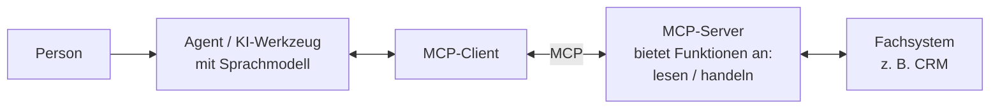

# Lab 2.3: KI mit allem verbinden: MCP

**Leitfragen:**

<details>
<summary>In wie vielen Systemen liegt das Wissen, das für eine typische Kundenanfrage nötig ist?</summary>

Oft in drei bis fünf: Mails und Dateien in Microsoft 365, Kundendaten im CRM, Rechnungen im ERP, Störungen im Ticketsystem. Copilot sieht davon zunächst nur Microsoft 365.

</details>

<details>
<summary>Fünf Systeme, drei Assistenten: wie viele Verbindungen braucht es, wenn jede einzeln gebaut wird?</summary>

Fünfzehn (5 × 3), und jede muss einzeln gebaut, geprüft und gepflegt werden. Mit einem gemeinsamen Anschluss-Standard sind es acht (5 + 3).

</details>

<details>
<summary>Sollte ein Assistent in einem Fachsystem nur lesen oder auch etwas ändern dürfen?</summary>

Zuerst nur lesen. Schreiben (Ticket anlegen, Datensatz ändern) erst, wenn Nutzen und Fehlerfolgen bekannt sind und ein Mensch vor dem Ausführen bestätigt.

</details>

<details>
<summary>Welche Daten würde das eigene Haus nie an einen Cloud-Dienst geben?</summary>

Häufig genannt: Personal- und Gesundheitsdaten, Kalkulationen, Geschäftsgeheimnisse. Für solche Daten kommt später ein KI-Modell auf eigenen Servern in Frage (lokales Modell, siehe unten).

</details>

- Wissen und Arbeit liegen auch außerhalb von Microsoft 365. MCP ist ein offener Standard, über den KI-Assistenten an solche Systeme angebunden werden.
- Jede Anbindung ist eine Entscheidung: welches System, nur lesen oder auch schreiben, wer betreibt die Anbindung, welches Modell verarbeitet die Daten.

## Begriffe

| Begriff | Bedeutung |
| --- | --- |
| Fachsystem | Software für eine Fachaufgabe außerhalb von Microsoft 365, z. B. CRM (Kunden und Angebote), ERP (Rechnungen, Budgets, Zeiterfassung), Ticketsystem (Support-Anfragen), Wiki |
| MCP (Model Context Protocol) | offener Standard, wie KI-Assistenten mit Fachsystemen sprechen; wie ein einheitlicher Anschluss (z. B. USB-C) statt eines eigenen Adapters je Gerät |
| MCP-Server | kleines Programm vor einem Fachsystem, das dessen Funktionen im MCP-Format anbietet, z. B. „Kunde suchen" oder „Ticket anlegen" |
| MCP-Client | Teil des KI-Werkzeugs, der mit MCP-Servern spricht und die angebotenen Funktionen dem Modell zur Verfügung stellt |
| Konnektor | Microsoft-Weg, Inhalte eines Fremdsystems in Microsoft 365 durchsuchbar zu machen (nur lesend) |
| Cloud-Modell | KI-Modell, das beim Anbieter im Rechenzentrum läuft, z. B. das Modell hinter Microsoft 365 Copilot |
| lokales Modell | KI-Modell, das auf eigenen Servern läuft; Daten verlassen das eigene Haus nicht |

## Das Problem: fünfzehn Einzelverbindungen

Nordwind hat neben Microsoft 365 ein CRM, ein ERP, ein Ticketsystem und ein Wiki (`nordwind-ausgangslage.md`). Angenommen, drei Assistenten sollen fünf Systeme nutzen:

```text
Ohne Standard: jede Verbindung einzeln        Mit MCP: jeder Teil einmal

Assistent 1 ─┬─ CRM, ERP, Tickets, Wiki, …     Assistent 1 ─┐            ┌─ MCP-Server CRM
Assistent 2 ─┼─ CRM, ERP, Tickets, Wiki, …     Assistent 2 ─┼── MCP ─────┼─ MCP-Server ERP
Assistent 3 ─┴─ CRM, ERP, Tickets, Wiki, …     Assistent 3 ─┘            ├─ MCP-Server Tickets
                                                                         ├─ MCP-Server Wiki
5 Systeme × 3 Assistenten = 15 Verbindungen                              └─ MCP-Server …
                                               5 Server + 3 Clients = 8 Bausteine
```

Jedes System wird einmal als MCP-Server bereitgestellt; jedes KI-Werkzeug mit MCP-Client kann es nutzen. Kommt ein vierter Assistent dazu, braucht es keine neue Verbindung je System.

## So funktioniert MCP



1. Der MCP-Client fragt den Server, welche Funktionen er anbietet (z. B. „Kunde suchen", „Angebotsstatus lesen").
2. Das Modell wählt zur Frage der Person eine passende Funktion.
3. Der Server führt sie im Fachsystem aus, mit den Rechten, die ihm dort eingeräumt sind, und liefert das Ergebnis zurück.
4. Das Modell formuliert daraus die Antwort.

**Fakten:** MCP wurde im November 2024 von Anthropic als offener Standard veröffentlicht und wird inzwischen von vielen KI-Werkzeugen und Anbietern unterstützt ([Anthropic](https://www.anthropic.com/news/model-context-protocol), [modelcontextprotocol.io](https://modelcontextprotocol.io); Stand: 31.10.2026, vor dem Kurs prüfen).

## Entscheiderfrage 1: lesen oder auch schreiben?

| | Nur lesen | Auch schreiben (handeln) |
| --- | --- | --- |
| Beispiel | Kundenstatus aus dem CRM vor einem Termin | Ticket aus einer Mail anlegen, Datensatz ändern |
| Fehlerfolge | falsche Antwort, die ein Mensch bemerken kann | falscher Eintrag im Fachsystem, wirkt weiter |
| Voraussetzung | passende Leserechte, Prüfung der Antwort | Bestätigung durch einen Menschen vor dem Ausführen, Protokoll, klarer Owner |
| Empfehlung | Start | erst nach erfolgreichem Lesebetrieb |

## Entscheiderfrage 2: wer betreibt den MCP-Server?

| Betreiber | Vorteil | Prüffrage |
| --- | --- | --- |
| Hersteller des Fachsystems | gepflegt, passt zur Software | Wo laufen die Daten, welche Funktionen sind freigeschaltet? |
| eigene IT | volle Kontrolle über Funktionen und Rechte | Wer pflegt, aktualisiert und überwacht ihn? |
| Drittanbieter oder frei verfügbarer Server | schnell verfügbar | Vertrauenswürdig? Welche Rechte bekommt er, wer haftet? |

Jeder MCP-Server erweitert, was ein Agent sehen und tun kann. Er braucht deshalb dieselbe Prüfung wie jede andere Software mit Zugriff auf Unternehmensdaten.

## Der Microsoft-Weg

Fremdsysteme kommen auf zwei Wegen zu Copilot: über Konnektoren, die Inhalte durchsuchbar machen (lesend), und über Agenten mit Aktionen bzw. MCP-Anbindung; dieser zweite Weg führt heute über Copilot Studio, nicht über den Agent Builder ([Microsoft Learn: Copilot connectors](https://learn.microsoft.com/en-us/microsoft-365/copilot/connectors/overview), [Agent Builder](https://learn.microsoft.com/en-us/microsoft-365/copilot/extensibility/agent-builder); Stand: 31.10.2026, vor dem Kurs prüfen).

## Cloud-Modell oder lokales Modell

Ein lokales Modell ist ein KI-Modell, das auf eigenen Servern läuft, sodass Daten das Haus nicht verlassen. Damit wird die Frage „welches Modell" je System entscheidbar:

| System | Typische Daten | Naheliegende Wahl |
| --- | --- | --- |
| CRM | Kunden, Kontakte, Angebotsstatus | Cloud-Modell im bestehenden Microsoft-365-Rahmen |
| Ticketsystem | Störungen, Lösungen | Cloud-Modell |
| ERP / Personaldaten | Budgets, Zeiterfassung, Gehälter | vorerst nicht anbinden; später lokales Modell prüfen |

> **Merksatz:** Ein Standard für alle Anschlüsse, aber eine Entscheidung je Anschluss: welches System, lesen oder schreiben, wer betreibt es, welches Modell.

## Grenzen

- MCP regelt, wie verbunden wird, nicht ob die Daten dafür geeignet sind. Unklare Berechtigungen im Fachsystem werden über den Agenten sichtbar.
- Nicht jedes KI-Werkzeug unterstützt jede MCP-Funktion; Unterstützung und Einrichtung vor der Entscheidung prüfen.
- Ein KI-Werkzeug, das Ergebnisse über MCP liest und zusammenfasst, kann sich verlesen; die Zusammenfassung wird gegen die Rohdaten geprüft.

## Fazit

- MCP ersetzt viele Einzelverbindungen durch einen offenen Standard: 5 + 3 statt 5 × 3.
- Start mit Lesen; Schreiben erst mit menschlicher Bestätigung.
- Für jeden MCP-Server sind Betreiber, Rechte und Owner zu klären.
- Sensible Systeme: vorerst nicht anbinden oder später mit lokalem Modell.

Die Übung lässt ein KI-Werkzeug Abstimmungsergebnisse über MCP lesen und prüft den daraus entstandenen Entwurf für den Abschnitt „Anbindung".
