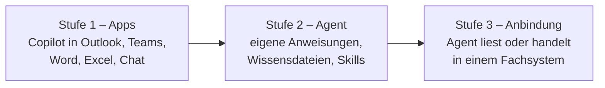

# Lab 2.4: Anwendungsfälle bewerten und priorisieren

**Leitfragen:**

Wie wird heute entschieden, welche neue Software ein Team zuerst bekommt?

Oft nach Lautstärke, Budget oder persönlicher Begeisterung. Eine einfache Matrix mit Nutzen, Machbarkeit und Risiko macht die Entscheidung vergleichbar und nachvollziehbar.

Was ist besser: ein großer Fall mit Risiko oder drei kleine sichere Fälle?

Für den Start meist die kleinen sicheren Fälle: schneller sichtbarer Nutzen, Lernkurve für die Organisation, geringe Fehlerfolgen. Der große Fall folgt, wenn die Maßnahmen gegen seine Risiken stehen.

Woran würde nach drei Monaten erkennbar sein, dass sich die Einführung gelohnt hat?

An einer Zahl, die vor dem Start gemessen wurde: weniger Tickets, kürzere Durchlaufzeit, häufigere Nutzung. „Alle sind zufriedener" lässt sich nicht prüfen.

- Nicht jeder gute Fall ist ein guter erster Fall: Priorität entsteht aus Nutzen und Machbarkeit, das Risiko bestimmt die Voraussetzungen.
- Erfolg wird vor dem Start festgelegt: Vorher-Wert, Zielwert, Frist.

## Begriffe

| Begriff | Bedeutung |
| --- | --- |
| Anwendungsfall | konkrete, wiederkehrende Aufgabe, bei der Copilot oder ein Agent hilft, mit Nutzergruppe und Kontext |
| Ausbaustufe | wie viel Einrichtung ein Fall braucht: Apps, eigener Agent oder Anbindung eines Fachsystems |
| Bewertungsmatrix | Tabelle, in der jeder Fall auf denselben Achsen mit 1 bis 3 bewertet wird |
| Erfolgskriterium | messbare Aussage mit Vorher-Wert, Zielwert und Frist, an der der Erfolg nach dem Pilot geprüft wird |

## Drei Nutzenarten

| Nutzenart | Frage | Nordwind-Beispiel |
| --- | --- | --- |
| Zeit | Was geht schneller? | lange Mailverläufe in Projekten schneller erfassen |
| Qualität | Was wird besser oder einheitlicher? | Angebote nach festen Hausregeln |
| Zugang zu Wissen | Wer kann jetzt selbst antworten, statt zu fragen? | neue Mitarbeitende finden Onboarding-Antworten ohne HR |

## Drei Ausbaustufen

Die Stufen bauen auf den bisherigen Labs auf: Copilot in den Apps (Lab 1.2), eigener Agent mit Skills (Lab 2.1, 2.2), Anbindung über MCP (Lab 2.3).

| Stufe | Aufwand | Typisches Risiko |
| --- | --- | --- |
| 1 – Apps | keiner außer Lizenz und Schulung | Ergebnis ungeprüft weitergegeben |
| 2 – Agent | Einrichtung, Owner, Pflege des Wissens | veraltetes Wissen, zu weiter Nutzerkreis |
| 3 – Anbindung | Projekt mit IT, MCP-Server oder Konnektor | Zugriff auf Fachdaten, Fehler beim Schreiben |

Faustregel: Ein Fall wird in der niedrigsten Stufe umgesetzt, die sein Problem löst.

## Die Bewertungsmatrix

Datei: `bewertungsmatrix.md` in den Projektdateien. Jeder Fall bekommt je Achse 1 (niedrig) bis 3 (hoch).

| Achse | 1 | 2 | 3 |
| --- | --- | --- | --- |
| **Nutzen** | wenige Personen, selten | eine Abteilung, wöchentlich | viele Personen, täglich |
| **Machbarkeit** (Kontext vorhanden, Lizenz, Aufwand) | Daten fehlen oder Fachsystem nötig | Daten vorhanden, Einrichtung nötig | Daten in Microsoft 365, sofort nutzbar |
| **Risiko** (grob) | intern, keine Personendaten | Kundendaten oder Außenwirkung | Personendaten, Entscheidungen über Menschen oder schreibender Zugriff |

- **Priorität = Nutzen + Machbarkeit** (2 bis 6).
- **Risiko** fließt nicht in die Summe ein: Risiko 3 heißt nicht „nein", sondern „erst nach den Maßnahmen starten" (vertieft in Modul 3).
- Bei Gleichstand gewinnt der Fall mit dem besser messbaren Erfolgskriterium.

**Beispiel:** Fall A „Mailverläufe in Projekten" (160 Personen, täglich, eigenes Postfach): Nutzen 3, Machbarkeit 3, Risiko 2 (Kundendaten, Antwortentwurf mit Außenwirkung) → Priorität 6, Start mit Prüfpflicht vor dem Versand.

## Erfolg messbar machen

Ein Erfolgskriterium nennt Vorher-Wert, Zielwert und Frist. Der Vorher-Wert wird vor dem Start erhoben, sonst lässt sich nach 90 Tagen nichts vergleichen.

| Unbrauchbar | Brauchbar |
| --- | --- |
| „Mitarbeitende sind zufriedener" | „Rückfragen neuer Mitarbeitender an HR sinken in den ersten 30 Tagen von durchschnittlich zwölf auf sechs pro Person (gemessen über zwei Onboarding-Jahrgänge)." |
| „Copilot wird viel genutzt" | „70 % der Pilotgruppe nutzen Copilot nach 60 Tagen mindestens dreimal pro Woche." |

> **Merksatz:** Erst bewerten, dann wählen, dann messen: Ohne Vorher-Wert gibt es nach dem Pilot keinen Erfolg, nur Meinungen.

## Typische Fehler

| Symptom | Ursache | Lösung |
| --- | --- | --- |
| Der spannendste Fall landet oben, scheitert aber an Daten | Machbarkeit zu optimistisch bewertet | prüfen, ob Kontext heute in Microsoft 365 liegt |
| Ein Fall mit Risiko 3 wird gestrichen | Risiko als Ausschluss verstanden | Maßnahmen benennen, Fall zurückstellen statt streichen |
| Nach dem Pilot ist unklar, ob er gewirkt hat | kein Vorher-Wert erhoben | Kennzahl vor dem Start messen |

## Fazit

- Drei Nutzenarten: Zeit, Qualität, Zugang zu Wissen.
- Drei Ausbaustufen: Apps → Agent → Anbindung; die niedrigste passende Stufe gewinnt.
- Priorität = Nutzen + Machbarkeit; Risiko bestimmt die Voraussetzungen.
- Ein Erfolgskriterium hat Vorher-Wert, Zielwert und Frist.

Die Übung schätzt die Stufe dreier Fälle, bewertet Fälle mit der Matrix und füllt den Abschnitt „Top-Anwendungsfall" der Entscheidungsvorlage.
