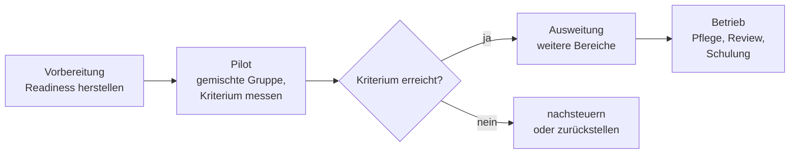

# Lab 4.2: Der 90-Tage-Plan

**Leitfragen:**

Wer sollte in einer Pilotgruppe sitzen – die Begeisterten oder eine Mischung?

Eine Mischung. Nur Begeisterte liefern zu gute Ergebnisse, die sich im Rollout nicht wiederholen. Eine Pilotgruppe aus mehreren Bereichen, Rollen und Haltungen, auch mit Skeptikern, zeigt, wie Copilot im Alltag wirklich ankommt.

Was muss erledigt sein, bevor die erste Lizenz vergeben wird?

Zuerst Freigaben und Ablage prüfen, dann Richtlinie, Datenschutz und Einbindung der Mitarbeitervertretung klären, Schulung und Support bereitstellen und festlegen, wie Erfolg gemessen wird. Die Readiness-Checkliste fasst das zusammen.

Wann ist ein Pilot gescheitert?

Nicht, wenn das Erfolgskriterium knapp verfehlt wird – dann wird nachgesteuert. Gescheitert ist ein Pilot, der ohne Vorher-Wert und Kriterium startet und deshalb nichts beweisen kann, oder der ein nicht beherrschbares Risiko zeigt.

- Einführung in Phasen: Vorbereitung → Pilot → Ausweitung → Betrieb.
- Vor der ersten Lizenz steht die Readiness, nicht die Technik.
- Erfolg wird mit dem Kriterium aus Lab 2.4 gemessen; das Ergebnis ist eine Empfehlung „starten / vorbereiten / zurückstellen".

## Begriffe

| Begriff | Bedeutung |
| --- | --- |
| Pilot | zeitlich begrenzter Test mit einer kleinen Gruppe, bevor eine Entscheidung für alle fällt. Wie eine Probefahrt vor dem Kauf. |
| Pilotgruppe | Personen, die im Pilot eine Lizenz erhalten und Rückmeldung geben |
| Readiness | Einsatzbereitschaft: organisatorische und technische Voraussetzungen sind erfüllt |
| Sponsor | Mitglied der Leitung, das die Einführung verantwortet, Ressourcen freigibt und Konflikte entscheidet |
| Owner | benannte Person, die für einen Agenten, einen Skill oder eine Anbindung inhaltlich verantwortlich ist (Lab 2.2, Lab 3.1) |

## Vier Phasen

| Phase | Inhalt | Ergebnis |
| --- | --- | --- |
| Vorbereitung | Freigaben aufräumen, Richtlinie, Vereinbarung, Datenschutz, Schulung, Vorher-Wert messen | Readiness-Checkliste erledigt |
| Pilot | gemischte Gruppe nutzt Copilot im Alltag, Champions begleiten | Messwerte, Rückmeldungen, Risiken |
| Ausweitung | weitere Bereiche, nächste Ausbaustufe | Lizenzen nach Bedarf |
| Betrieb | Agenten, Skills und Anbindungen pflegen und regelmäßig prüfen, Schulung fortführen | stabile Nutzung |

## Readiness vor der ersten Lizenz

Die [Readiness-Checkliste](../../project/readiness-checkliste.md) enthält zwölf Prüffragen in fünf Gruppen:

| Gruppe | Punkte | Verweis |
| --- | --- | --- |
| Daten | Berechtigungen, Ablage, Vertraulichkeit | Lab 1.2, Lab 3.1 |
| Regeln | KI-Richtlinie, Mitarbeitervertretung, Datenschutz | Lab 3.1–3.3 |
| Menschen | Schulung, Support, Kommunikation | Lab 4.1 |
| Ausbau | Agenten und Skills, Anbindungen | Lab 2.1–2.3 |
| Messung | Vorher-Wert, Zielwert, Frist | Lab 2.4 |

Jeder Punkt ist vor dem Pilotstart erledigt oder bewusst mit Begründung zurückgestellt.

## Lizenzentscheidung

| Option | Passt, wenn … | Achtung |
| --- | --- | --- |
| Copilot Chat für alle, Microsoft 365 Copilot für eine Pilotgruppe | Nutzen noch nicht belegt, Readiness nur teilweise erfüllt | Regeln für Copilot Chat gelten trotzdem für alle |
| breiter Start mit Microsoft 365 Copilot | Readiness erfüllt, Nutzen in vielen Bereichen erwartet | höhere Kosten, Oversharing wirkt sofort für alle |
| Lizenzen nach Nutzung | Pilot ausgewertet, Nutzung je Rolle bekannt | Nutzung regelmäßig prüfen, ungenutzte Lizenzen umverteilen |

Lizenzmodell und Lizenznamen ändern sich häufig. Stand: 31.10.2026. Funktionsumfang hängt von Lizenz, Tenant-Einstellungen und Rollout ab; vor dem Kurs prüfen.

## Ausbaustufen

Die drei Stufen aus Lab 2.4 bestimmen die Reihenfolge: erst **Copilot in den Apps**, dann **ein erster Agent mit Skills**, dann **Anbindung eines Fachsystems** (zuerst nur lesend, Lab 2.3). Jede Stufe beginnt erst, wenn die vorige stabil läuft und ihre Owner benannt sind.

## Rollen und Verantwortung

| Rolle | Verantwortung | Bei Nordwind (Beispiel) |
| --- | --- | --- |
| Sponsor | Ziel, Budget, Entscheidung nach dem Pilot | Geschäftsführung |
| Projektleitung | Plan, Termine, Messung, Bericht | eine Bereichsleitung |
| IT | Lizenzen, Freigaben, technische Einstellungen, Anbindungen | IT-Leitung |
| Datenschutz | Compliance-Checkliste, Datenschutz-Folgenabschätzung | externe Datenschutzbeauftragte |
| Mitarbeitervertretung | Vereinbarung, Evaluierung | Betriebsrat |
| Champions | Hilfe im Team, Rückmeldungen, erste Skills | je Bereich ein bis zwei Personen |
| Agenten- und Skill-Owner | Inhalt aktuell halten, Prüfturnus | Fachbereich, z. B. IT für den IT-Helfer |

## Erfolg messen

- Das Kriterium aus Lab 2.4 hat einen Vorher-Wert, einen Zielwert und eine Frist.
- Der Vorher-Wert wird in der Vorbereitung gemessen, nicht erst im Pilot.
- Ergänzend: Nutzung (wie viele Personen arbeiten regelmäßig mit Copilot), Rückmeldungen der Pilotgruppe und gemeldete Risiken; Nutzungsdaten nur zusammengefasst, nicht je Person (Lab 3.3).

| Empfehlung | Wann |
| --- | --- |
| starten | Readiness erfüllt, Pilot kann sofort beginnen |
| vorbereiten | Nutzen plausibel, aber wichtige Readiness-Punkte offen; Plan beginnt mit deren Erledigung |
| zurückstellen | kein messbarer Nutzen oder ein Risiko, das sich derzeit nicht begrenzen lässt |

> **Merksatz:** Ein Pilot ohne Vorher-Wert beweist nichts – auch keinen Erfolg.

## Fazit

- Vorbereitung zuerst: Freigaben, Regeln, Menschen, Messung.
- Pilot mit gemischter Gruppe und einem messbaren Kriterium aus Lab 2.4.
- Ausbau in Stufen, jede mit benannten Owner und Rollen.
- Am Ende steht eine begründete Empfehlung: starten, vorbereiten oder zurückstellen.

In der Übung wird Abschnitt 10 der Entscheidungsvorlage abgeschlossen: Pflichtpunkte, Pilotgruppe, Erfolgskriterium, Meilensteine und Empfehlung.
